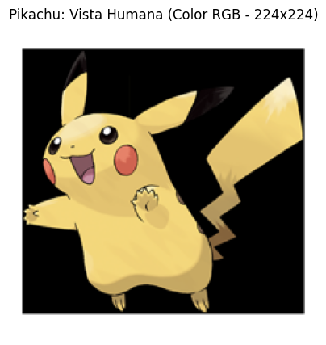
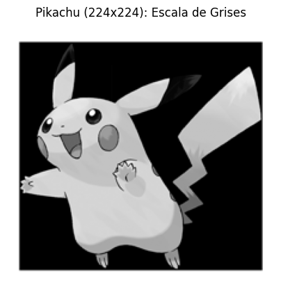
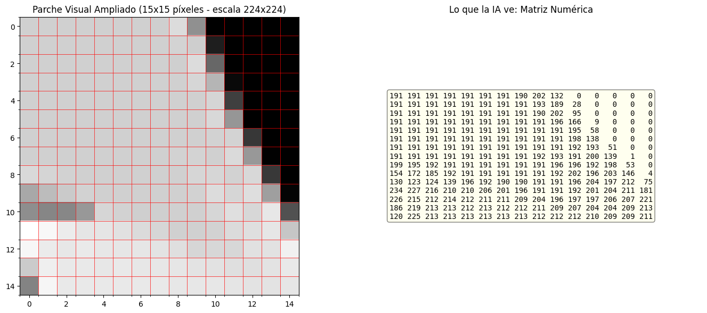
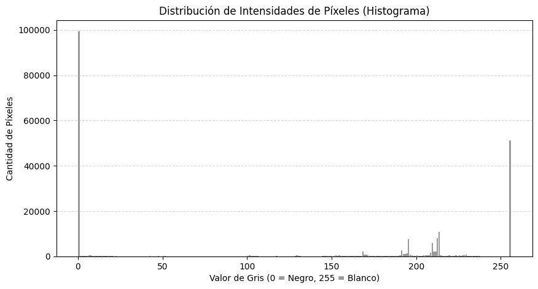
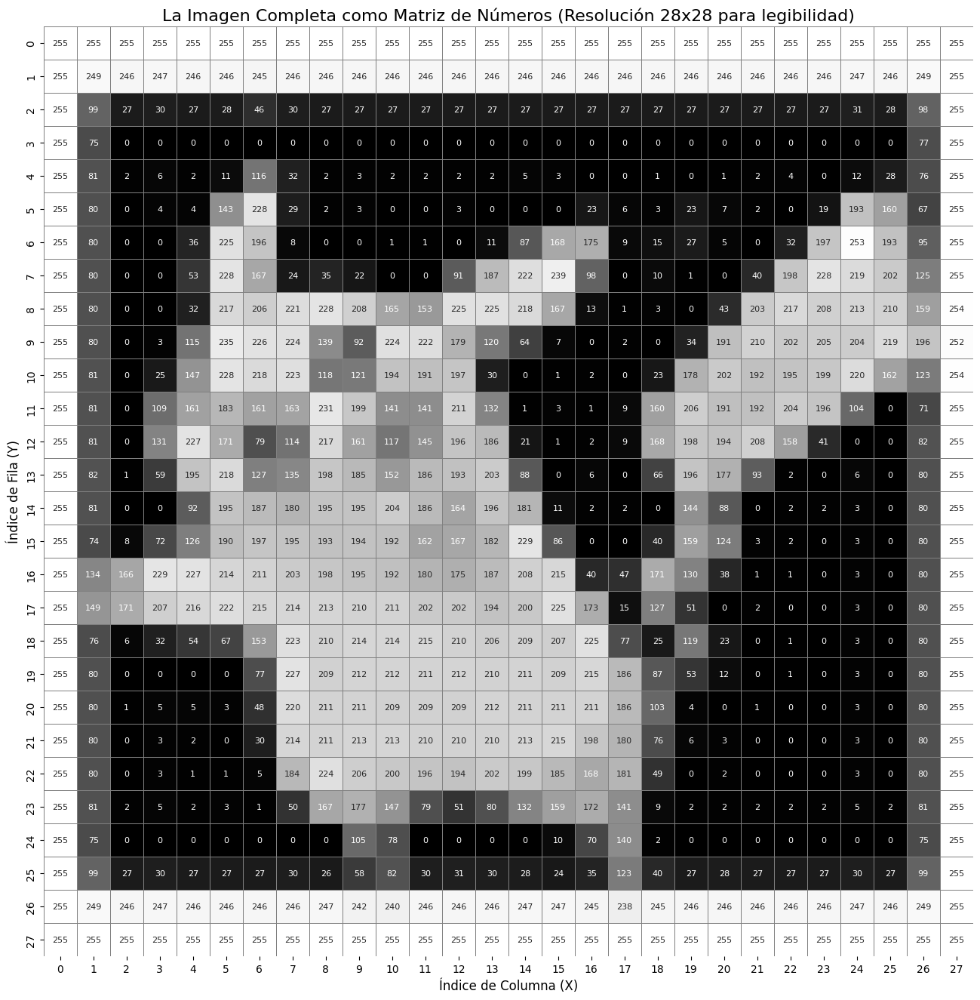

# ⚡ De Píxeles a Tensores: Cómo una IA "Ve" a Pikachu

[](https://colab.research.google.com/drive/1NZ-JFab6gLV5uFiZkw1F1b_OLeiNSZ13?usp=sharing)


> **Proyecto de Portafolio en Ingeniería Informática / Computer Vision**  
> Demostración didáctica y rigurosa sobre cómo los algoritmos de Visión por Computadora e Inteligencia Artificial perciben, procesan y transforman los datos visuales: desde tensores RGB tridimensionales hasta matrices numéricas y mapas de intensidad.

---

## 📌 Tabla de Contenidos
1. [Descripción del Proyecto](#-descripción-del-proyecto)
2. [Estructura del Proyecto](#-estructura-del-proyecto)
3. [Flujo de Procesamiento y Código](#-flujo-de-procesamiento-y-código)
   - [1. Descarga y Carga de la Imagen](#1-descarga-y-carga-de-la-imagen-de-pikachu)
   - [2. Conversión a Escala de Grises](#2-conversión-a-escala-de-grises)
   - [3. La Perspectiva de la Máquina: El Vector Numérico](#3-la-perspectiva-de-la-máquina-el-vector-numérico)
   - [4. Histograma de la Imagen](#4-histograma-de-la-imagen)
   - [5. Representación Numérica de la Imagen Completa](#5-representación-numérica-de-la-imagen-completa)
   - [6. Mapa de Calor Interactivo (Plotly)](#6-mapa-de-calor-interactivo-matriz-28x28)
4. [Tecnologías y Librerías](#-tecnologías-y-librerías)
5. [Ejecución en Local](#-ejecución-en-local)

---

## 📖 Descripción del Proyecto

Para el ojo humano, una imagen digital es una composición continua de formas, colores y contrastes. Sin embargo, para una computadora o una red neuronal, no existen "formas" ni "colores": **todo son tensores y matrices de números discretos**.

En este proyecto se utiliza la imagen oficial de Pikachu para recorrer paso a paso la pipeline básica de preprocesamiento en Computer Vision:
* Carga y estandarización a resolución $224 \times 224 \times 3$ (formato canónico de modelos como ResNet o VGG).
* Reducción de dimensionalidad mediante luminancia estándar (ponderación perceptual del ojo humano).
* Inspección de parches locales a nivel de píxel ($15 \times 15$).
* Análisis estadístico de distribución de intensidades lumínicas (Histograma).
* Visualización global en formato matricial con **Seaborn** (resolución $28 \times 28$, análogo al dataset MNIST).
* Visualización interactiva mediante **Plotly**.

---

## 📂 Estructura del Proyecto

```text
Matriz_Pikachu_pixel/
├── images/
│   ├── 01_pikachu_rgb.png
│   ├── 02_pikachu_grayscale.png
│   ├── 03_parche_vector_numerico.png
│   ├── 04_histograma_intensidades.png
│   └── 05_matriz_calor_28x28.png
├── Matriz_Pikachu_pixel.ipynb   # Notebook con el código original y visualizaciones
└── README.md                    # Documentación técnica del proyecto
```

---

## 🚀 Flujo de Procesamiento y Código

### 1. Descarga y Carga de la Imagen de Pikachu
Primero, importamos las librerías necesarias (`numpy`, `matplotlib`, `PIL`, `requests`) y descargamos una imagen de Pikachu para trabajar con ella.

```python
import numpy as np
import matplotlib.pyplot as plt
from PIL import Image
import requests
from io import BytesIO

# URL de una imagen de Pikachu
url = "https://raw.githubusercontent.com/PokeAPI/sprites/master/sprites/pokemon/other/official-artwork/25.png"
response = requests.get(url)

# Descargar y redimensionar directamente a 224x224 (Estándar para modelos de IA)
img = Image.open(BytesIO(response.content)).convert("RGB").resize((224, 224))

# Convertir a array de numpy (Cubo de datos: 224 x 224 x 3 Canales)
img_np = np.array(img)

print(f"Dimensiones de la imagen original a color (Alto, Ancho, Canales): {img_np.shape}")
plt.figure(figsize=(5, 5))
plt.imshow(img_np)
plt.title("Pikachu: Vista Humana (Color RGB - 224x224)")
plt.axis('off')
plt.show()
```

**Salida en consola:**
```text
Dimensiones de la imagen original a color (Alto, Ancho, Canales): (224, 224, 3)
```

<p align="center">
  
</p>

---

### 2. Conversión a Escala de Grises
Para una IA, procesar tres canales ($R$, $G$, $B$) requiere tres veces más cálculos que procesar un solo canal. Al convertir la imagen a escala de grises, reducimos las dimensiones de la matriz de `(Alto, Ancho, 3)` a simplemente `(Alto, Ancho)`. Cada píxel ahora se representa con un único número del $0$ (negro) al $255$ (blanco) utilizando la fórmula de luminancia estándar ITU-R BT.601:

$$Y = 0.299 \cdot R + 0.587 \cdot G + 0.114 \cdot B$$

```python
# Convertir a escala de grises usando la fórmula de luminancia estándar
img_gray = np.dot(img_np[...,:3], [0.299, 0.587, 0.114]).astype(np.uint8)

print(f"Nuevas dimensiones de la imagen en escala de grises (Alto, Ancho): {img_gray.shape}")

plt.figure(figsize=(5, 5))
plt.imshow(img_gray, cmap='gray')
plt.title("Pikachu (224x224): Escala de Grises")
plt.axis('off')
plt.show()
```

**Salida en consola:**
```text
Nuevas dimensiones de la imagen en escala de grises (Alto, Ancho): (224, 224)
```

<p align="center">
  
</p>

---

### 3. La Perspectiva de la Máquina: El Vector Numérico
Una IA no "ve" formas ni colores; ve matrices numéricas. Vamos a extraer una pequeña sección de la mejilla o el cuerpo de Pikachu (una cuadrícula de $15 \times 15$ píxeles) y mostraremos tanto la imagen ampliada como la matriz de números reales que la componen.

```python
# Al haber cambiado la resolución a 224x224, recalculamos el centro de la imagen
alto, ancho = img_gray.shape
centro_y, centro_x = alto // 2, ancho // 2

# Extraemos un parche de 15x15 píxeles del rostro de Pikachu
parche = img_gray[centro_y-7:centro_y+8, centro_x-7:centro_x+8]

fig, axes = plt.subplots(1, 2, figsize=(14, 6))

# Mostrar el parche visualmente
axes[0].imshow(parche, cmap='gray', interpolation='nearest')
axes[0].set_title("Parche Visual Ampliado (15x15 píxeles - escala 224x224)")
axes[0].set_xticks(np.arange(-0.5, 15, 1), minor=True)
axes[0].set_yticks(np.arange(-0.5, 15, 1), minor=True)
axes[0].grid(which='minor', color='red', linestyle='-', linewidth=0.5)

# Mostrar la matriz numérica
axes[1].axis('off')
matriz_texto = "\n".join([" ".join([f"{val:3d}" for val in fila]) for fila in parche])
axes[1].text(0.5, 0.5, matriz_texto, fontsize=10, family='monospace',
             ha='center', va='center', bbox=dict(boxstyle='round', facecolor='lightyellow', alpha=0.5))
axes[1].set_title("Lo que la IA ve: Matriz Numérica")

plt.tight_layout()
plt.show()
```

<p align="center">
  
</p>

---

### 4. Histograma de la Imagen
Un histograma de frecuencias nos permite analizar la distribución de todos los tonos de gris de la imagen. Esto ayuda a la IA a comprender si la imagen es generalmente oscura, clara o si tiene mucho contraste.

```python
plt.figure(figsize=(10, 5))

# Generar el histograma
# .ravel() aplana la matriz bidimensional en un vector unidimensional de píxeles
plt.hist(img_gray.ravel(), bins=256, range=(0, 256), color='gray', alpha=0.8, rwidth=0.9)

plt.title("Distribución de Intensidades de Píxeles (Histograma)")
plt.xlabel("Valor de Gris (0 = Negro, 255 = Blanco)")
plt.ylabel("Cantidad de Píxeles")
plt.grid(axis='y', linestyle='--', alpha=0.5)

plt.show()
```

<p align="center">
  
</p>

---

### 5. Representación Numérica de la Imagen Completa
Para poder visualizar la totalidad de Pikachu como una cuadrícula de números legible, reduciremos temporalmente la escala de la imagen de grises a una resolución de **$28 \times 28$** (el tamaño clásico usado en redes como LeNet / MNIST). Esto nos permite imprimir de forma visual y exacta el mapa numérico completo de la silueta de Pikachu.

```python
import seaborn as sns

# Redimensionar la imagen de grises completa a 28x28 usando PIL para conservar la silueta de Pikachu
img_pil_gray = Image.fromarray(img_gray)
img_mini = img_pil_gray.resize((28, 28), Image.Resampling.LANCZOS)
img_mini_np = np.array(img_mini)

# Crear un mapa de calor gigante con los valores numéricos de todos los píxeles de la imagen
plt.figure(figsize=(20, 16))
sns.heatmap(img_mini_np, annot=True, fmt="d", cmap="gray", cbar=False, square=True,
            annot_kws={"size": 8}, linewidths=0.5, linecolor="gray")

plt.title("La Imagen Completa como Matriz de Números (Resolución 28x28 para legibilidad)", fontsize=16)
plt.xlabel("Índice de Columna (X)", fontsize=12)
plt.ylabel("Índice de Fila (Y)", fontsize=12)
plt.show()
```

<p align="center">
  
</p>

---

### 6. Mapa de Calor Interactivo (Matriz 28x28)
Utilizando la librería `plotly`, crearemos un gráfico interactivo. Puedes pasar el cursor por encima de cada celda para descubrir el valor exacto del píxel que la máquina procesa.

> [!NOTE]  
> **¿Por qué probarlo en Google Colab?**  
> GitHub desactiva la ejecución de JavaScript en los archivos `README.md` por políticas de seguridad (prevención de ataques XSS), por lo que los gráficos interactivos de Plotly son estáticos en esta vista.  
>  
> **Para experimentar con la versión interactiva y pasar el cursor sobre los píxeles en tiempo real, abre el notebook directamente en Colab:**  
> [](https://colab.research.google.com/drive/1NZ-JFab6gLV5uFiZkw1F1b_OLeiNSZ13?usp=sharing)

```python
import plotly.graph_objects as go

# Invertir verticalmente la matriz para que coincida con la orientación del gráfico estándar de imagen
matriz_espejo = np.flipud(img_mini_np)

fig = go.Figure(data=go.Heatmap(
    z=matriz_espejo,
    colorscale='Gray',
    showscale=True,
    hoverongaps=False,
    hovertemplate='Columna (X): %{x}<br>Fila (Y): %{y}<br>Valor de Gris: %{z}<extra></extra>'
))

fig.update_layout(
    title='Mapa de Calor Interactivo del Pikachu Completo (Pasa el cursor sobre los píxeles)',
    xaxis=dict(title='Índice de Columna (X)', dtick=1),
    yaxis=dict(title='Índice de Fila (Y)', dtick=1),
    width=800,
    height=800,
    autosize=False
)

fig.show()
```

---

## 🛠️ Tecnologías y Librerías

* **Python 3.9+**
* **[NumPy](https://numpy.org/):** Manipulación de tensores, inversión matricial (`np.flipud`), aplanado (`ravel`) y producto punto (`np.dot`).
* **[Pillow (PIL)](https://pillow.readthedocs.io/):** Carga, conversión de espacios de color y remuestreo con filtros Lanczos.
* **[Matplotlib](https://matplotlib.org/):** Gráficos en subplots, visualización de matrices e histogramas de frecuencias.
* **[Seaborn](https://seaborn.pydata.org/):** Renderizado de matrices de calor de alta resolución con anotación de valores discretos.
* **[Plotly](https://plotly.com/python/):** Gráficos dinámicos con soporte para tooltips e inspección interactiva.
* **[Requests](https://requests.readthedocs.io/):** Consumo del endpoint REST de PokeAPI.

---

## 💻 Ejecución en Local

Si deseas clonar y ejecutar este proyecto en tu entorno local:

1. **Clonar el repositorio:**
   ```bash
   git clone https://github.com/pamionj/matriz-pikachu-pixel
   cd matriz-pikachu-pixel
   ```

2. **Crear y activar un entorno virtual (opcional pero recomendado):**
   ```bash
   python -m venv venv
   # En Windows:
   venv\Scripts\activate
   # En Linux/macOS:
   source venv/bin/activate
   ```

3. **Instalar dependencias:**
   ```bash
   pip install numpy matplotlib pillow requests seaborn plotly jupyter
   ```

4. **Lanzar Jupyter Notebook:**
   ```bash
   jupyter notebook Matriz_Pikachu_pixel.ipynb
   ```

---

## 👤 Autor

* **Desarrollador:** [https://github.com/pamionj](https://github.com/pamionj)
* **LinkedIn:** [https://linkedin.com/in/pamionj](https://linkedin.com/in/pamionj)
